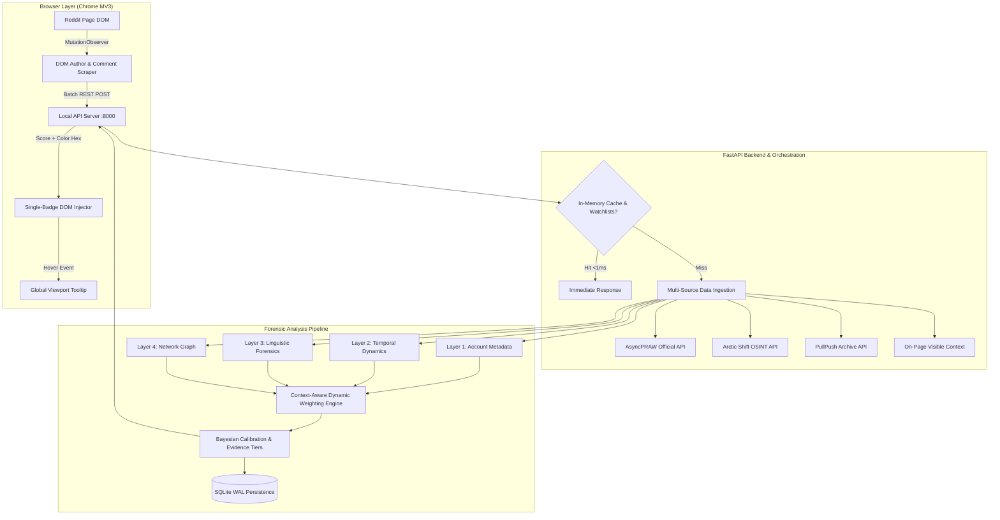

# System Architecture & Technical Design Overview

> **Reddit Bot Identifier — Architectural Documentation Suite**  
> *Version:* 2.0  
> *Status:* Production Ready  
> *Module Index:* [Index](file:///home/lazy_pirate/projects/reddit-bot-identifier/docs/00_Architecture_and_System_Overview.md) | [01 Data Pipeline](file:///home/lazy_pirate/projects/reddit-bot-identifier/docs/01_Data_Pipeline_and_Multi_Archive_OSINT.md) | [02 Dynamic Weighting](file:///home/lazy_pirate/projects/reddit-bot-identifier/docs/02_Context_Aware_Dynamic_Weighting_Engine.md) | [03 Behavioral Forensics](file:///home/lazy_pirate/projects/reddit-bot-identifier/docs/03_Four_Layer_Behavioral_Forensics.md) | [04 Evidence Hierarchy](file:///home/lazy_pirate/projects/reddit-bot-identifier/docs/04_Three_Tier_Evidence_Hierarchy_and_Latency.md) | [05 Extension UI](file:///home/lazy_pirate/projects/reddit-bot-identifier/docs/05_Browser_Extension_and_DOM_Architecture.md) | [06 Benchmark Validation](file:///home/lazy_pirate/projects/reddit-bot-identifier/docs/06_Benchmark_Methodology_and_Validation.md)

---

## 1. Executive Summary & Design Philosophy

The **Reddit Bot Identifier** is a real-time, multi-layered threat detection and behavioral analysis platform designed to distinguish automated bots, coordinated astroturfing rings, and programmatic propaganda accounts from genuine human Redditors. 

Modern social media manipulation has evolved past crude, high-frequency script bots. Today's adversarial landscape features:
1. **LLM-Powered Astroturfers:** Accounts generating fluent, contextually relevant, and polite English text that defeats traditional keyword and sentiment analysis.
2. **Sleeper & Aged Sockpuppets:** Accounts registered years in advance, left dormant to accrue age, and then activated for political propaganda or stock manipulation.
3. **Hidden-Profile Evasion:** Accounts utilizing Reddit's native privacy toggle to hide comment histories from standard public endpoints (`/user/<username>/comments.json`).
4. **Coordinated Multi-Account Rings:** Syndicates that coordinate upvotes, cross-post links across hundreds of subreddits, and employ reciprocal comment pairs.

To defeat these modern evasions, the Reddit Bot Identifier abandons naive static weighting and single-vector classification in favor of a **non-linear, multi-tier forensic pipeline** backed by real-time OSINT historical recovery and a **Context-Aware Dynamic Weighting Engine**.

---

## 2. High-Level Component Architecture

The system is composed of five decoupled, specialized subsystems:

### A. Client-Side Browser Extension (`extension/`)
- Built on **Manifest V3** with zero external dependencies for maximum speed and security.
- Operates a high-performance `MutationObserver` targeting Old Reddit, New Reddit, and Modern Reddit (Shreddit).
- Features a **Single-Badge UI philosophy**: eliminates visual clutter by rendering a subtle percentage badge strictly adjacent to author handles.
- Renders a floating, viewport-aware global tooltip containing granular layer breakdowns, active signals, and evidentiary tiers without DOM clipping.

### B. High-Throughput Local REST API (`src/server.py`)
- Asynchronous HTTP server powered by `aiohttp.web` serving `http://127.0.0.1:8000`.
- Provides batch scanning endpoints (`/api/scan-users`) capable of evaluating up to 50 users concurrently.
- Enforces an **In-Memory LRU Cache ($TTL = 3600\text{s}$)** and an $O(1)$ memory registry for instant $(<1\text{ms})$ responses on common accounts.

### C. Multi-Source OSINT Recovery Pipeline (`src/collectors/reddit_collector.py`)
- Solves Reddit's comment-hiding privacy features by orchestrating automated fallbacks across public archives:
  1. Primary: AsyncPRAW (Official Reddit API)
  2. Public OSINT 1: **Arctic Shift API** (Historical comments and submissions)
  3. Public OSINT 2: **PullPush API** (Alternative Pushshift archive)
  4. Real-Time Scraping: Direct On-Page DOM Comment Harvesting

### D. Four-Layer Forensic Feature Engine (`src/features/`)
- **Metadata Extractor (`metadata_extractor.py`):** Algorithmic username patterns, account age decay, dormancy sleepers, and karma asymmetry.
- **Temporal Analyzer (`temporal_analyzer.py`):** 24-bucket Circadian entropy, 48-hour circular rest-gap analysis (sleep absence), Inter-Arrival Time (IAT) regularity, burst density, and subreddit topical monomania.
- **Text Forensics (`text_forensics.py`):** Exact and fuzzy Jaro-Winkler bot phrase matching, LLM stylometric marker extraction, Flesch Reading Ease consistency, and template duplication.
- **Network Mapper (`network_mapper.py`):** Thread co-occurrence tracking, reciprocal reply clustering, and associative guilt with known malicious actors.

### E. Context-Aware Dynamic Weighting Engine (`src/models/bot_classifier.py`)
- Dynamically redistributes scoring weights based on contextual anomaly profiles.
- Solves the **Clean Grammar Dilution Vulnerability** via **Linguistic Decoupling**: slashes text weighting when clean grammar masks superhuman posting schedules.
- Dynamically adapts to single-subreddit monomania, propaganda cluster activity, and sparse histories while enforcing strict mathematical normalization ($\sum w_i = 1.000$).

---

## 3. Modular Documentation Map

To provide deep technical clarity without information overload, this documentation suite is organized into modular, interlinked reports:

| Report | Document Title | Primary Focus & System Covered |
|---|---|---|
| **[01](file:///home/lazy_pirate/projects/reddit-bot-identifier/docs/01_Data_Pipeline_and_Multi_Archive_OSINT.md)** | **Data Pipeline & Multi-Archive OSINT** | API ingestion, Arctic Shift & PullPush fallbacks, post recovery, SQLite WAL storage. |
| **[02](file:///home/lazy_pirate/projects/reddit-bot-identifier/docs/02_Context_Aware_Dynamic_Weighting_Engine.md)** | **Context-Aware Dynamic Weighting Engine** | Mathematical formulation, Linguistic Decoupling, anomaly boosts, normalization proofs. |
| **[03](file:///home/lazy_pirate/projects/reddit-bot-identifier/docs/03_Four_Layer_Behavioral_Forensics.md)** | **Four-Layer Behavioral Forensics** | Algorithmic analysis of Metadata, Temporal Dynamics, Text Forensics, and Network Graph. |
| **[04](file:///home/lazy_pirate/projects/reddit-bot-identifier/docs/04_Three_Tier_Evidence_Hierarchy_and_Latency.md)** | **Three-Tier Evidence Hierarchy & Latency** | Deterministic vs Watchlist vs Forensics, $O(1)$ RAM registry, $<1\text{ms}$ query optimization. |
| **[05](file:///home/lazy_pirate/projects/reddit-bot-identifier/docs/05_Browser_Extension_and_DOM_Architecture.md)** | **Browser Extension & DOM Integration** | Chrome MV3 content script, single-badge UI, continuous 7-tier color gradient, DOM scraper. |
| **[06](file:///home/lazy_pirate/projects/reddit-bot-identifier/docs/06_Benchmark_Methodology_and_Validation.md)** | **Benchmark Methodology & Real-World Validation** | 15 ground-truth accounts, edge-case bots (`tippr`, `r2tg_bot`), 100% precision audit. |

---

## 4. Architectural Decisions & Design Trade-Offs

### Decision 1: Local HTTP API Server vs. Pure In-Browser Client
- *Alternative Considered:* Running all feature extraction and API calls directly inside the browser extension content script.
- *Rationale for Decision:* Browser extensions face CORS limitations, severe memory constraints, lack SQLite persistence, and cannot easily maintain long-lived connection pools to Reddit/OSINT endpoints. By running a lightweight local daemon ([`server.py`](file:///home/lazy_pirate/projects/reddit-bot-identifier/src/server.py)), the extension acts strictly as a lightweight DOM renderer, while heavy natural language processing, regex compilations, and asynchronous archive fetching run in Python.

### Decision 2: Tri-Source OSINT Recovery vs. Reliance on Official Reddit API
- *Alternative Considered:* Relying solely on official Reddit OAuth2 / AsyncPRAW.
- *Rationale for Decision:* Modern bot operators deliberately hide their comment history or operate across shadowbanned states. Furthermore, Reddit's strict rate limits frequently disrupt live scanning. Integrating **Arctic Shift** and **PullPush** public archives guarantees reliable history reconstruction even when the target's Reddit profile is private or the official API is rate-limited.

### Decision 3: Dynamic Context-Aware Weighting vs. Static Linear Model
- *Alternative Considered:* Using a fixed weighted sum (e.g. $0.25 \times S_{\text{meta}} + 0.25 \times S_{\text{temp}} + 0.30 \times S_{\text{ling}} + 0.20 \times S_{\text{net}}$).
- *Rationale for Decision:* Fixed weights suffer from the **dilution vulnerability**. A bot running GPT-4 generates near-perfect human text ($S_{\text{ling}} \approx 0.05$). Under static weighting, this human-like text score severely dilutes an otherwise blatant temporal anomaly ($S_{\text{temp}} = 0.90$), causing the bot to score $0.55$ (SUSPECT/HUMAN). The dynamic weighting engine identifies this incongruity and automatically decouples linguistic weighting, allowing behavioral signals to dominate.

### Decision 4: In-Memory O(1) Watchlist Registry vs. Database Lookup
- *Alternative Considered:* Querying SQLite for every single username encountered on a Reddit page.
- *Rationale for Decision:* Reddit threads frequently contain 200+ comments. Repeated SQLite queries create disk I/O bottlenecks and introduce visible lag (10–15 seconds). Pre-loading known community bots and validated humans into a memory hash map ([`_WATCHLIST_MAP`](file:///home/lazy_pirate/projects/reddit-bot-identifier/src/server.py#L35)) enables $O(1)$ sub-millisecond evaluation for instant UI badge rendering.

---

> [!TIP]
> **Next Step:** To explore how data is ingested, cached, and recovered from public archives when profiles are hidden, proceed to **[01 Data Pipeline & Multi-Archive OSINT](file:///home/lazy_pirate/projects/reddit-bot-identifier/docs/01_Data_Pipeline_and_Multi_Archive_OSINT.md)**.

