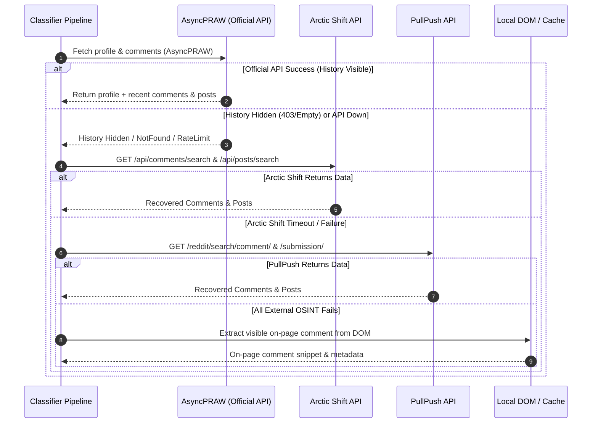

# Data Pipeline & Multi-Archive OSINT Recovery

> **Reddit Bot Identifier — Architectural Documentation Suite**  
> *Module:* 01 | *Status:* Production Ready  
> *Navigation:* [← Overview](file:///home/lazy_pirate/projects/reddit-bot-identifier/docs/00_Architecture_and_System_Overview.md) | **01 Data Pipeline** | [02 Dynamic Weighting →](file:///home/lazy_pirate/projects/reddit-bot-identifier/docs/02_Context_Aware_Dynamic_Weighting_Engine.md)

---

## 1. The Challenge: Reddit Data Obfuscation & Ephemerality

To conduct robust forensic analysis of any Reddit account, an engine must inspect a representative sample of historical activity (timestamps, subreddits, karma accrual, and linguistic style). However, real-world data collection faces significant obstacles:

1. **Native Profile Privacy Toggles:** Reddit allows users to toggle their post and comment histories to private. When enabled, requests to `/user/<username>/comments.json` return an empty list or HTTP 403 Forbidden.
2. **Account Deletions & Shadowbans:** Bots that wipe their previous comments or operate under shadowbanned states fail native profile resolution (`asyncpraw.exceptions.NotFound`).
3. **API Rate Limiting & Outages:** Reddit's official API enforces strict rate limits (60–100 requests per minute). During high-traffic comment streaming or bulk page audits, unauthenticated or standard script keys quickly encounter HTTP 429 throttling.
4. **Post Submission Ignorance:** Many spam engines operate primarily by submitting links or text posts rather than commenting. Analyzing only comments leaves a blind spot for link-farming networks.

---

## 2. Multi-Archive Tri-Source Fallback Pipeline

To guarantee data availability, the Reddit Bot Identifier implements a multi-tiered ingestion engine in [`src/collectors/reddit_collector.py`](file:///home/lazy_pirate/projects/reddit-bot-identifier/src/collectors/reddit_collector.py#L67-L174). When a user profile is fetched, the system follows a resilient fallback hierarchy:



### Ingestion Source Specifications

| Ingestion Tier | Primary Endpoint / Mechanism | Data Retrieved | Failure Triggers |
|---|---|---|---|
| **Tier 1: Official API** | `asyncpraw.Reddit.redditor()` | Live karma, account age, verified email, recent comments/submissions | Profile set to private, suspended, shadowbanned, or HTTP 429 rate limit |
| **Tier 2: Arctic Shift OSINT** | `https://arctic-shift.photon-reddit.com/api/` | Historical comments and submissions from Reddit's firehose archive | Archive lag, network timeout ($>8\text{s}$) |
| **Tier 3: PullPush Archive** | `https://api.pullpush.io/reddit/search/` | Independent Pushshift mirror archive | Server throttling, network timeout ($>8\text{s}$) |
| **Tier 4: On-Page Context** | Client-Side Content Script (`content.js`) | Visible comment body and ID currently rendered on the browser page | Comment text omitted in DOM |

---

## 3. Dual-Entity Ingestion: Merging Comments & Post Submissions

Historically, bot identifiers only evaluated comments (`comment.body`). This proved fatal when classifying bots like `r2tg_bot` (which cross-posts image submissions across telegram-bridging subreddits) or crypto tip bots that post selftext summaries.

The updated pipeline explicitly fetches, normalizes, and unifies both entities:

```python
# src/collectors/reddit_collector.py
profile.recent_comments = comments

# Also fetch submissions / posts
posts = []
async for sub in redditor.submissions.new(limit=min(max_comments // 2, 50)):
    posts.append({
        "id": sub.id,
        "title": sub.title,
        "body": f"{sub.title}\n{sub.selftext}".strip() if getattr(sub, "selftext", None) else sub.title,
        "subreddit": str(sub.subreddit),
        "created_utc": sub.created_utc,
        "score": sub.score,
        "permalink": sub.permalink,
        "submission_id": sub.id,
        "parent_id": "",
        "is_post": True,
    })
profile.recent_posts = posts
```

### De-duplication and Synthesis
In [`src/models/bot_classifier.py`](file:///home/lazy_pirate/projects/reddit-bot-identifier/src/models/bot_classifier.py#L284-L327), comments and posts are merged into a unified timeline:
1. Historical comments from the local SQLite database are retrieved.
2. Posts are transformed into standard textual records where `body = title + "\n" + selftext`.
3. An active set of observed IDs (`known_ids`) prevents duplicate analysis across archive sources.
4. If an on-page visible comment was scraped by the browser extension, it is prepended to the head of the timeline.

This synthesis ensures that temporal analyzers inspect the **true circadian activity pattern** of the user across both posting and commenting modes.

---

## 4. Local State Caching & Persistence Architecture

To guarantee low latency and prevent redundant external API requests, data persistence is handled via a multi-tiered caching strategy:

```
[Incoming Request]
       │
       ▼
[In-Memory LRU Cache] ────(Hit: <0.1ms)────► Return cached JSON
       │
      Miss
       ▼
[SQLite DB (users table)] ──(Hit: <5ms)─────► Return cached record (if age < TTL)
       │
      Miss
       ▼
[Network OSINT Pipeline] ──(1-3 seconds)───► Compute, Upsert SQLite, Update RAM Cache
```

### SQLite Database Design ([`src/db/database.py`](file:///home/lazy_pirate/projects/reddit-bot-identifier/src/db/database.py))
The local database utilizes **SQLite in WAL (Write-Ahead Logging) mode**, allowing non-blocking concurrent reads by the API server while background comment stream monitors perform write transactions:

```sql
PRAGMA journal_mode = WAL;
PRAGMA synchronous = NORMAL;
```

#### Core Database Tables:
- `users`: Tracks known Redditors, their latest aggregate scores ($S_{\text{meta}}, S_{\text{temporal}}, S_{\text{linguistic}}, S_{\text{network}}$), account creation date, karma tallies, and private history indicators.
- `comments`: Historical comment and submission log containing comment bodies, timestamps, subreddits, and matched bot phrases.
- `analysis_log`: Audit trail recording timestamped forensic breakdowns, active dynamic weights, and detected signal notes for every scan execution.
- `watchlists`: Curated repository of verified bots and human controls for $O(1)$ fast-path resolution.

---

## 5. Graceful Degradation Under Sparse Data

When an account is newly registered ($<7\text{ days}$) or has zero historical records in both Reddit and public archives, the data pipeline flags `history_hidden = True` and sets `sample_size = 0`.

Rather than failing or producing a false-positive classification, the pipeline passes the sparse record to the **Context-Aware Dynamic Weighting Engine**, which automatically:
- Downweights unobservable temporal variance from $0.25 \to 0.05$.
- Eliminates missing network graphs ($w_{\text{network}} \to 0.00$).
- Concentrates evaluation weight on observable metadata ($w_{\text{meta}} = 0.40$) and the on-page triggering comment ($w_{\text{linguistic}} = 0.45$).

---

> [!NOTE]
> The multi-archive fallback guarantees that even if a bot operator deliberately sets their Reddit profile to private, their historical footprint across public mirrors is ingested seamlessly.

---

> [!TIP]
> **Next Step:** To examine the mathematical mechanics of how weights shift when analyzing different account profiles, proceed to **[02 Context-Aware Dynamic Weighting Engine](file:///home/lazy_pirate/projects/reddit-bot-identifier/docs/02_Context_Aware_Dynamic_Weighting_Engine.md)**.
