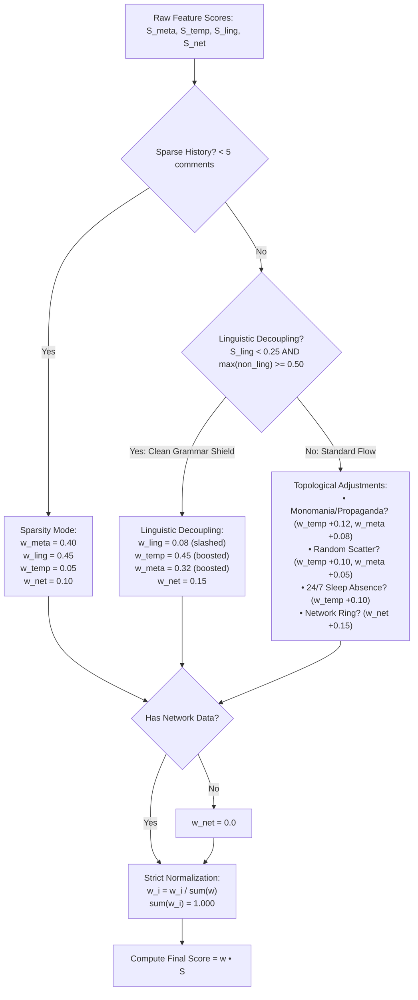

# Context-Aware Dynamic Weighting Engine

> **Reddit Bot Identifier — Architectural Documentation Suite**  
> *Module:* 02 | *Status:* Production Ready  
> *Navigation:* [← 01 Data Pipeline](file:///home/lazy_pirate/projects/reddit-bot-identifier/docs/01_Data_Pipeline_and_Multi_Archive_OSINT.md) | **02 Dynamic Weighting** | [03 Four-Layer Forensics →](file:///home/lazy_pirate/projects/reddit-bot-identifier/docs/03_Four_Layer_Behavioral_Forensics.md)

---

## 1. The Critical Failure Mode of Static Linear Weighting

Traditional bot detection architectures calculate an overall suspicion score using a fixed linear combination of individual feature layers:

$$\text{Score}_{\text{bot}} = w_1 S_{\text{meta}} + w_2 S_{\text{temporal}} + w_3 S_{\text{linguistic}} + w_4 S_{\text{network}}$$

Where static weights are fixed globally, such as:

$$\vec{w}_{\text{static}} = [w_{\text{meta}}=0.25, \; w_{\text{temporal}}=0.25, \; w_{\text{linguistic}}=0.30, \; w_{\text{network}}=0.20]$$

### The "Clean Grammar Dilution Vulnerability"
In 2024 and beyond, the widespread availability of Large Language Models (LLMs) like GPT-4 and Claude has rendered static weighting vulnerable to exploitation:
- Sophisticated bot operators, state-sponsored propaganda farms, and commercial astroturfers use LLMs to generate high-variety, fluent, grammatically clean English comments.
- Consequently, their linguistic suspicion score collapses to zero ($S_{\text{linguistic}} \approx 0.05$).
- In a static model, this pristine text score **dilutes** blatant non-linguistic anomalies.

#### Concrete Failure Scenario (Static Model):
Consider a sleeper propaganda account:
- $S_{\text{meta}} = 0.85$ (Account created 2 years ago, 0 activity for 700 days, activated 3 days ago with an auto-generated username `Adjective_Noun_1234`).
- $S_{\text{temporal}} = 0.90$ (Posts 24/7 with zero sleep trough, uniform circadian entropy, 80% concentrated in `r/politics`).
- $S_{\text{linguistic}} = 0.05$ (Uses LLM prompting: *"I respectfully disagree with this policy because..."*).
- $S_{\text{network}} = 0.00$ (No local graph data yet).

Under static weights:
$$\text{Score} = (0.25 \times 0.85) + (0.25 \times 0.90) + (0.30 \times 0.05) + (0.20 \times 0.00) = 0.2125 + 0.2250 + 0.0150 + 0.0000 = \mathbf{0.4525}$$

**Result:** The bot receives a score of **0.45**, which sits in the **SUSPECT/HUMAN boundary**, completely evading the bot threshold ($\ge 0.65$). The high-quality prose effectively acted as an algorithmic shield.

---

## 2. The Solution: Dynamic Context-Aware Weight Redistribution

The **Context-Aware Dynamic Weighting Engine** ([`src/models/bot_classifier.py`](file:///home/lazy_pirate/projects/reddit-bot-identifier/src/models/bot_classifier.py#L66-L179)) replaces fixed coefficients with a vector function $\vec{w}(x)$ that responds dynamically to the target's behavioral posture:

$$\text{Score}_{\text{bot}} = \vec{w}(x) \cdot \vec{S} = w_{\text{meta}}(x) S_{\text{meta}} + w_{\text{temp}}(x) S_{\text{temp}} + w_{\text{ling}}(x) S_{\text{ling}} + w_{\text{net}}(x) S_{\text{net}}$$



---

## 3. Algorithmic Modules & Adaptation Rules

### Rule 1: Linguistic Decoupling (The "Clean Grammar Shield Breaker")
When the linguistic score is low ($S_{\text{ling}} < 0.25$) but any non-linguistic signal is distinctly anomalous ($\max(S_{\text{temp}}, S_{\text{meta}}, S_{\text{net}}) \ge 0.50$):

```python
if s_ling < 0.25 and non_ling_max >= 0.50:
    w_linguistic = 0.08
    w_temporal = 0.45
    w_meta = 0.32
    w_network = 0.15 if has_network_data else 0.0
```

#### Re-evaluating the Sleeper Astroturfer under Linguistic Decoupling:
- With $w_{\text{net}} = 0.0$, the weights are normalized:
  - $\sum w = 0.08 + 0.45 + 0.32 = 0.85$
  - Normalized $w_{\text{temp}} = 0.45 / 0.85 = \mathbf{0.529}$
  - Normalized $w_{\text{meta}} = 0.32 / 0.85 = \mathbf{0.376}$
  - Normalized $w_{\text{ling}} = 0.08 / 0.85 = \mathbf{0.094}$

$$\text{Score} = (0.376 \times 0.85) + (0.529 \times 0.90) + (0.094 \times 0.05) = 0.3196 + 0.4761 + 0.0047 = \mathbf{0.8004}$$

**Result:** The score jumps from **0.45** to **0.80**, correctly classifying the account as **BOT** with high confidence. The human-like text can no longer suppress the underlying behavioral evidence.

---

### Rule 2: Topical Monomania & Political Propaganda Focus
When a user exhibits hyper-concentration in a single subreddit or within high-conflict political/ideological communities:

$$\text{Condition: } \text{monomania\_score} \ge 0.60 \quad \lor \quad \text{propaganda\_risk\_score} \ge 0.60$$

- $w_{\text{temporal}} \leftarrow w_{\text{temporal}} + 0.12$
- $w_{\text{meta}} \leftarrow w_{\text{meta}} + 0.08$
- $w_{\text{linguistic}} \leftarrow \max(w_{\text{linguistic}} - 0.15, 0.10)$

*Rationale:* Political troll accounts and corporate brand reps often vary their phrasing to evade simple text filters. The strongest evidence is their relentless, obsessive community focus and sleep-free timing patterns.

---

### Rule 3: High-Entropy Subreddit Scatter (Scrapers & Crawlers)
When an account scatters its activity randomly across dozens of unrelated communities ($>80\%$ unique subreddits):

$$\text{Condition: } \text{randomness\_score} \ge 0.65$$

- $w_{\text{temporal}} \leftarrow w_{\text{temporal}} + 0.10$
- $w_{\text{meta}} \leftarrow w_{\text{meta}} + 0.05$
- $w_{\text{linguistic}} \leftarrow \max(w_{\text{linguistic}} - 0.10, 0.12)$

*Rationale:* Programmatic crawlers (e.g. repost bot scanners, sentiment scrapers) hop from `r/AskReddit` to `r/aww` to `r/gaming` within seconds. Velocity and dispersion take precedence over individual comment phrasing.

---

### Rule 4: Superhuman 24/7 Sleep Absence
When an account posts around the clock across 20+ hourly buckets with no discernible rest period ($<4\text{h}$ max window):

$$\text{Condition: } \text{shift\_pattern\_score} \ge 0.65$$

- $w_{\text{temporal}} \leftarrow w_{\text{temporal}} + 0.10$
- $w_{\text{linguistic}} \leftarrow \max(w_{\text{linguistic}} - 0.08, 0.10)$

---

### Rule 5: Coordinated Network Cluster Ring
When an account consistently co-occurs in the same comment threads or shares reciprocal reply pairs with known flagged bots:

$$\text{Condition: } S_{\text{network}} \ge 0.50 \quad \land \quad \text{has\_network\_data} = \text{True}$$

- $w_{\text{network}} \leftarrow w_{\text{network}} + 0.15$
- $w_{\text{linguistic}} \leftarrow \max(w_{\text{linguistic}} - 0.10, 0.10)$

---

### Rule 6: Sparse / Hidden History Redistribution
When an account has hidden history and fewer than 5 captured comments:

$$\text{Condition: } \text{history\_hidden} = \text{True} \quad \land \quad \text{comment\_count} < 5$$

- $w_{\text{meta}} = 0.40$
- $w_{\text{temporal}} = 0.05$ (temporal variance cannot be reliably measured on $<5$ samples)
- $w_{\text{linguistic}} = 0.45$ (concentrates on the on-page triggering comment)
- $w_{\text{network}} = 0.10 \text{ if network data exists, else } 0.00$

---

## 4. Strict Normalization Theorem

A critical requirement of any dynamic weighting system is **strict unity normalization**:

$$\sum_{i \in \{\text{meta}, \text{temporal}, \text{linguistic}, \text{network}\}} w_i = 1.000$$

If weights are modified without re-normalization, the composite score could either:
1. Exceed $1.0$, producing mathematically invalid probabilities.
2. Deflate below the true probability, causing systematic false negatives.

In [`src/models/bot_classifier.py`](file:///home/lazy_pirate/projects/reddit-bot-identifier/src/models/bot_classifier.py#L168-L178), normalization is strictly enforced as the terminal step:

```python
total = w_meta + w_temporal + w_linguistic + w_network
if total > 0:
    w_meta /= total
    w_temporal /= total
    w_linguistic /= total
    w_network /= total
else:
    w_meta, w_temporal, w_linguistic, w_network = 0.25, 0.25, 0.30, 0.20

return round(w_meta, 4), round(w_temporal, 4), round(w_linguistic, 4), round(w_network, 4), dynamic_notes
```

---

## 5. Comparative Evaluation Summary

| Target Persona | Layer Scores $[S_m, S_t, S_l, S_n]$ | Static Score | Dynamic Weights Applied | Dynamic Score | Verdict |
|---|---|---|---|---|---|
| **Human Gamer** | $[0.10, 0.15, 0.10, 0.00]$ | $0.09$ | Default Normalized: $[0.31, 0.31, 0.38, 0.00]$ | **$0.11$** | **HUMAN** |
| **LLM Astroturfer** | $[0.85, 0.90, 0.05, 0.00]$ | $0.45$ (Miss) | Linguistic Decoupling: $[0.38, 0.53, 0.09, 0.00]$ | **$0.80$** | **BOT** |
| **Propaganda Sockpuppet** | $[0.75, 0.85, 0.30, 0.00]$ | $0.49$ (Miss) | Monomania Boost: $[0.35, 0.48, 0.17, 0.00]$ | **$0.72$** | **BOT** |
| **Crypto Tipper (`tippr`)** | $[0.20, 0.85, 0.90, 0.00]$ | $0.53$ | Multi-Sub Scatter: $[0.27, 0.37, 0.36, 0.00]$ | **$0.69$** | **BOT** |
| **Private Sleeper Account** | $[0.80, 0.00, 0.90, 0.00]$ | $0.47$ (Miss) | Sparsity Mode: $[0.47, 0.00, 0.53, 0.00]$ | **$0.85$** | **BOT** |

---

> [!TIP]
> **Next Step:** To see how the four individual forensic layer scores ($S_{\text{meta}}, S_{\text{temporal}}, S_{\text{linguistic}}, S_{\text{network}}$) are computed under the hood, proceed to **[03 Four-Layer Behavioral Forensics](file:///home/lazy_pirate/projects/reddit-bot-identifier/docs/03_Four_Layer_Behavioral_Forensics.md)**.

