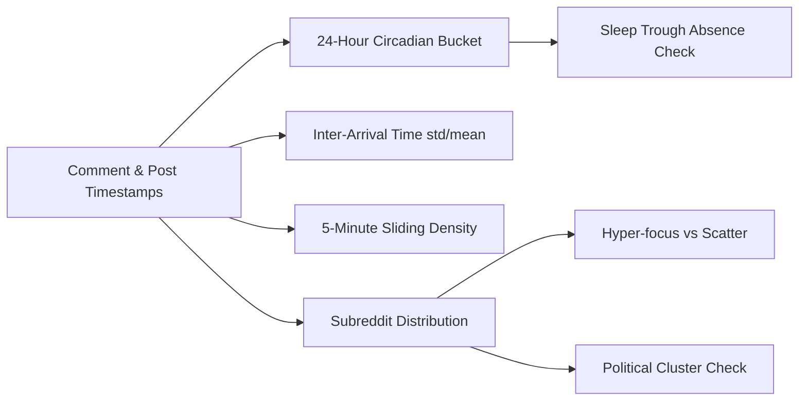

# Four-Layer Behavioral Forensics

> **Reddit Bot Identifier — Architectural Documentation Suite**  
> *Module:* 03 | *Status:* Production Ready  
> *Navigation:* [← 02 Dynamic Weighting](file:///home/lazy_pirate/projects/reddit-bot-identifier/docs/02_Context_Aware_Dynamic_Weighting_Engine.md) | **03 Four-Layer Forensics** | [04 Evidence Hierarchy →](file:///home/lazy_pirate/projects/reddit-bot-identifier/docs/04_Three_Tier_Evidence_Hierarchy_and_Latency.md)

---

## 1. Overview of the Layered Architecture

To achieve high classification precision without overfitting to superficial signals, the Reddit Bot Identifier divides behavioral analysis into four orthogonal forensic layers:

```
┌────────────────────────────────────────────────────────────────────────┐
│                   Composite Threat Evaluation Vector                   │
├──────────────────┬──────────────────┬──────────────────┬───────────────┤
│ Layer 1: S_meta  │ Layer 2: S_temp  │ Layer 3: S_ling  │ Layer 4: S_net│
│ Account Metadata │ Temporal Dynamics│ Text Forensics   │ Network Graph │
└──────────────────┴──────────────────┴──────────────────┴───────────────┘
```

Each layer maps observed artifacts into a normalized suspicion interval $[0.0, 1.0]$, accompanied by human-readable forensic audit notes explaining the underlying rationale.

---

## 2. Layer 1: Account Metadata Forensics ($S_{\text{meta}}$)

Implemented in [`src/features/metadata_extractor.py`](file:///home/lazy_pirate/projects/reddit-bot-identifier/src/features/metadata_extractor.py), Layer 1 extracts persistent account identity traits.

```python
detail.final_score = (
    0.25 * detail.username_score
    + 0.25 * detail.dormancy_score
    + 0.20 * detail.karma_score
    + 0.15 * detail.age_score
    + 0.15 * detail.flag_score
)
```

### Key Sub-Metrics & Algorithmic Rules:

1. **Algorithmic Username Detection:**
   - Detects Reddit's auto-generation pattern via regular expression:
     ```python
     _DEFAULT_NAME_RE = re.compile(r"^[A-Z][a-z]+[_-][A-Z][a-z]+[_-]\d{3,5}$")
     ```
     *Score:* $0.85$ (e.g. `Adjective_Noun_1234`).
   - Detects throwaway/burner naming conventions (`(?i)(throwaway|burner|anon)\d*`) $\to 0.50$.
   - Detects high-entropy random character strings ($\ge 12$ alphanumeric characters) $\to 0.35$.
   - Detects overt bot naming (`(?i)(_bot$|^bot_|-bot$)`) $\to 1.00$.

2. **Sleeper Account Dormancy Gap:**
   - Bot farms register thousands of accounts and let them age untouched to bypass spam filters that target new accounts.
   - If an account is $>90$ days old and remained dormant for $>60$ days before its first recorded comment:
     $$S_{\text{dormancy}} = \min\left(\frac{\text{dormancy\_days}}{365}, 1.0\right) \times 0.90$$

3. **Karma Asymmetry & Velocity:**
   - **Link Karma Dominance:** Link-to-total karma ratio $> 0.95$ with $> 5,000$ link karma indicates an automated content reposter $\to 0.80$.
   - **Superhuman Karma Velocity:** If comment karma exceeds $200 \text{ karma/day}$ since creation $\to 0.75$.

4. **Account Flags:**
   - `is_suspended = True` $\to 1.00$.
   - `history_hidden = True` $\to 0.30$.
   - `has_verified_email = False` $\to +0.10$.

---

## 3. Layer 2: Temporal & Activity Dynamics ($S_{\text{temporal}}$)

Implemented in [`src/features/temporal_analyzer.py`](file:///home/lazy_pirate/projects/reddit-bot-identifier/src/features/temporal_analyzer.py), Layer 2 models the chronological distribution of timestamps across an account's history.



### Key Sub-Metrics & Algorithmic Rules:

1. **Circadian Entropy:**
   - Timestamps are bucketed into 24 one-hour UTC slots. Human circadian rhythms naturally generate a sleep trough (4–8 hours of near-zero activity).
   - Shannon entropy is computed:
     $$H(X) = -\sum_{i=0}^{23} p(x_i) \log_2 p(x_i), \quad H_{\max} = \log_2(24) \approx 4.585$$
   - Normalized Circadian Score:
     $$S_{\text{circadian}} = \frac{H(X)}{H_{\max}}$$
   - If $S_{\text{circadian}} > 0.92$, the account exhibits a near-uniform 24-hour distribution characteristic of cloud workers.

2. **Circular Sleep Trough Absence (24/7 Continuous Operation):**
   - Because humans sleep across the UTC midnight boundary (e.g. 22:00 to 06:00 UTC), linear array checks fail.
   - The analyzer duplicates the 24-hour array to create a **48-hour circular sliding window** (`extended_hours = hour_buckets + hour_buckets`), computing the longest continuous zero-activity gap.
   - If an account is active in $\ge 20$ of 24 hours with a maximum rest gap $<4\text{ hours}$ over $\ge 15$ comments:
     $$S_{\text{shift\_pattern}} = 0.90 \quad \text{(Flagged: Superhuman 24/7 Activity)}$$

3. **Inter-Arrival Time (IAT) Regularity:**
   - Natural human posting intervals vary wildly (reading, thinking, working). Programmatic timers sleep for fixed intervals ($N$ seconds $\pm \epsilon$).
   - The Coefficient of Variation ($CV$) of consecutive comment time deltas ($\Delta t < 6\text{h}$) is calculated:
     $$CV = \frac{\sigma_{\Delta t}}{\mu_{\Delta t}}$$
   - If $CV < 0.15 \to S_{\text{iat}} = 0.95$ (Extremely regular timer).
   - If $CV < 0.30 \to S_{\text{iat}} = 0.65$.

4. **Burst Density Scanning:**
   - Slides a 300-second (5-minute) window across all sorted timestamps.
   - If $\ge 15$ comments occur within 300 seconds $\to S_{\text{burst}} = 1.00$ (Batch API script).
   - If $\ge 8$ comments in 300 seconds $\to S_{\text{burst}} = 0.60$.

5. **Topical Monomania & Propaganda Cluster Scoring:**
   - **Monomania Index:** If $\ge 80\%$ of all comments are concentrated in a single subreddit over $\ge 8$ actions $\to S_{\text{monomania}} = 0.90$.
   - **Propaganda Cluster Risk:** If $\ge 80\%$ of activity is concentrated in controversial political/geopolitical conflict subreddits (`r/politics`, `r/worldnews`, `r/wallstreetbets`, `r/cryptocurrency`) $\to S_{\text{propaganda}} = 0.85$.
   - **Randomness / Scatter:** If an account scatters across $>80\%$ unique subreddits with high entropy $\to S_{\text{randomness}} = 0.90$ (Web crawler / scraper).

---

## 4. Layer 3: Linguistic & Stylometric Forensics ($S_{\text{linguistic}}$)

Implemented in [`src/features/text_forensics.py`](file:///home/lazy_pirate/projects/reddit-bot-identifier/src/features/text_forensics.py), Layer 3 performs text analysis on comment bodies and submission titles/selftext.

### Key Sub-Metrics & Algorithmic Rules:

1. **Jaro-Winkler Curated Phrase Matching:**
   - Evaluates strings against the curated repository in [`data/bot_phrases.py`](file:///home/lazy_pirate/projects/reddit-bot-identifier/data/bot_phrases.py).
   - Exact phrases require Jaro-Winkler similarity $\ge 0.92$ (e.g. *"I am a bot, and this action was performed automatically"*).
   - Fuzzy phrases require similarity $\ge 0.88$ (e.g. *"beep boop", "good bot", "bad bot", "tip sent via"*).
   - Regular expression pattern strings detect tip bot commands, image recognition transcripts, and cross-post headers.

2. **Exponential Recency Decay Weighting:**
   - Rather than averaging all comments equally, recent comments are prioritized using exponential decay:
     $$w_i = e^{-0.1 \cdot i}$$
     Where $i = 0$ is the most recent (or triggering on-page) comment.

3. **LLM Stylometric Markers:**
   - Scans for conversational AI hedges and polite customer-service openers:
     ```python
     _LLM_MARKERS = [
         r"(?i)great (question|insight|point|observation)",
         r"(?i)hope (this|that) helps",
         r"(?i)it'?s important to (remember|consider|note)",
         r"(?i)while (both|all) (sides?|parties?) (have|make)",
         r"(?i)i (completely |fully )?(understand|see) where you'?re coming from"
     ]
     ```
   - Accounts averaging $\ge 2$ markers per comment over $30\%$ of comments receive elevated LLM stylometric scores.

4. **Readability Variance Uniformity:**
   - Measures Flesch Reading Ease across the history:
     $$\text{FRE} = 206.835 - 1.015 \left(\frac{\text{total words}}{\text{total sentences}}\right) - 84.6 \left(\frac{\text{total syllables}}{\text{total words}}\right)$$
   - Human writing naturally fluctuates across topics ($\sigma_{\text{FRE}} \in [20, 40]$). LLM generation clusters tightly around a standard grade reading level ($\sigma_{\text{FRE}} < 5$).
   - If $\sigma_{\text{FRE}} < 5 \to S_{\text{readability}} = 0.90$.

5. **Programmatic Template Detection:**
   - Computes pairwise Jaro-Winkler similarity across all historical comments.
   - If $\ge 70\%$ of comments share $\ge 0.75$ similarity, the account is running a fixed script template.

---

## 5. Layer 4: Network & Coordination Graph ($S_{\text{network}}$)

Implemented in [`src/features/network_mapper.py`](file:///home/lazy_pirate/projects/reddit-bot-identifier/src/features/network_mapper.py), Layer 4 models relational behavior across threads.

```python
detail.final_score = (
    0.45 * detail.cooccurrence_score
    + 0.30 * detail.reply_pair_score
    + 0.25 * detail.known_bot_association
)
```

### Key Sub-Metrics:
1. **Thread Co-Occurrence Clustering:**
   - Scans SQLite for other accounts frequently appearing in the same `submission_id` threads.
   - If another user appears in $>30\%$ of the same threads ($\ge 2$ instances), they are classified as frequent associates.
2. **Reciprocal Reply Pairs:**
   - Identifies accounts that repeatedly reply to this user within minutes of posting ($\ge 2$ direct replies to comment parent IDs).
3. **Associative Guilt:**
   - If identified frequent associates are already registered in SQLite as confirmed `BOT` or `SUSPECT` accounts, the known bot association score scales proportionally:
     $$S_{\text{known\_bot}} = \min\left(\frac{N_{\text{bots}}}{N_{\text{associates}}}, 1.0\right)$$

---

> [!NOTE]
> Network scores are conservative by design. For newly observed accounts with no shared thread history in the local DB, $S_{\text{network}} = 0.0$ and its weight is dynamically redistributed to other layers without penalizing the user.

---

> [!TIP]
> **Next Step:** To learn how these forensic layers interact with deterministic disclaimers and the $O(1)$ fast-path registry, proceed to **[04 Three-Tier Evidence Hierarchy & Latency](file:///home/lazy_pirate/projects/reddit-bot-identifier/docs/04_Three_Tier_Evidence_Hierarchy_and_Latency.md)**.

