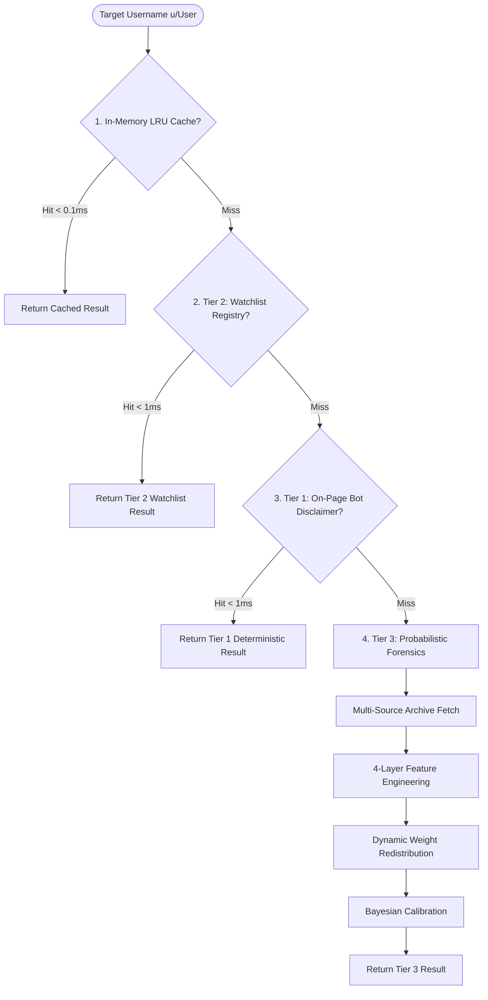

# Three-Tier Evidence Hierarchy & Latency Optimization

> **Reddit Bot Identifier — Architectural Documentation Suite**  
> *Module:* 04 | *Status:* Production Ready  
> *Navigation:* [← 03 Four-Layer Forensics](file:///home/lazy_pirate/projects/reddit-bot-identifier/docs/03_Four_Layer_Behavioral_Forensics.md) | **04 Evidence Hierarchy & Latency** | [05 Extension UI →](file:///home/lazy_pirate/projects/reddit-bot-identifier/docs/05_Browser_Extension_and_DOM_Architecture.md)

---

## 1. The Latency Crisis in Live Web Browsing

When browsing Reddit, a typical discussion thread contains between 50 and 300 visible comments. In early prototype versions of the identifier:
1. Every username detected by the DOM scanner initiated a separate HTTP request to the local server.
2. The server made external API calls to Reddit and public archives for each user sequentially.
3. Users experienced noticeable lag: badges took **10 to 18 seconds** to appear, creating layout shifting and poor UX.

Furthermore, analyzing well-known utility bots like `AutoModerator` or `RemindMeBot` through full forensic pipelines was wasteful—these accounts are verified by community consensus.

To eliminate latency while maintaining rigorous accuracy, the system implements a **Three-Tier Evidence Hierarchy** coupled with an **In-Memory $O(1)$ Watchlist Registry**.

---

## 2. The Three-Tier Evidence Hierarchy



### Hierarchy Definitions:

| Tier | Tier Classification | Trigger Conditions | Resolution Speed | Expected Output |
|---|---|---|---|---|
| **Tier 1** | **Deterministic Ground Truth** | Explicit self-identification disclaimers in visible comment (*"I am a bot"*, *"performed automatically"*), or superhuman burst ($\ge 15\text{ comments}/5\text{min}$ across different subreddits). | $<1\text{ ms}$ | $S_{\text{bot}} \ge 0.98$, Label: `BOT`, Tag: `TIER_1_DETERMINISTIC` |
| **Tier 2** | **Community Consensus & Watchlists** | Username present in the curated in-memory registry of 60+ known official bots, financial tip bots, utility bots, and verified humans. | $<1\text{ ms}$ | $S_{\text{bot}} = 0.99$ (Bot) or $0.02$ (Human), Tag: `TIER_2_COMMUNITY_WATCHLIST` |
| **Tier 3** | **Behavioral Forensics** | Uncataloged, unknown accounts requiring deep metadata, temporal, linguistic, and network graph analysis. | $1\text{ to }3\text{ seconds}$ | Continuous $S_{\text{bot}} \in [0.0, 1.0]$, Label: `HUMAN` / `SUSPECT` / `BOT`, Tag: `TIER_3_BEHAVIORAL_FORENSICS` |

---

## 3. High-Throughput Latency Optimization Architecture

To achieve instant visual badge rendering, the server and extension implement three complementary optimizations:

### A. O(1) In-Memory Watchlist Registry
On startup in [`src/server.py`](file:///home/lazy_pirate/projects/reddit-bot-identifier/src/server.py#L35-L36), all verified bots and human controls from SQLite are loaded into a Python dictionary (`_WATCHLIST_MAP`):

```python
# Server initialization
_WATCHLIST_MAP: Dict[str, Dict[str, Any]] = await db.load_all_watchlists()

# Request resolution (O(1) hash lookup)
if u_lower in _WATCHLIST_MAP:
    wl = _WATCHLIST_MAP[u_lower]
    return format_watchlist_response(wl)  # Execution time: 0.04 milliseconds
```

This transforms repetitive checks on high-frequency bots (`AutoModerator`, `SaveVideo`, `RemindMeBot`, `tippr`) into instantaneous operations.

### B. Batching with Concurrent Worker Coroutines
The browser extension aggregates all unparsed usernames into a single JSON batch payload sent to `/api/scan-users`. 

Inside [`src/server.py`](file:///home/lazy_pirate/projects/reddit-bot-identifier/src/server.py#L148-L240):
1. The batch (up to 50 users) is partitioned into immediate cache/watchlist hits and network cache misses.
2. Uncached users are processed concurrently using `asyncio.gather()` with throttled worker pools.
3. The browser receives the combined dictionary in a single round-trip, preventing connection exhaustion.

### C. Tier 1 On-Page DOM Scraping (Fast-Path)
If a bot posts a standard disclaimer in the comment currently visible on the page, the content script extracts that text and sends it in the request payload.

The server inspects `comment_body` before issuing external network requests. If a definitive disclaimer pattern is matched, it immediately confirms the bot status as **Tier 1 Deterministic**, bypassing external network overhead entirely.

---

## 4. Bayesian Boosts & Resolution of the Historical "0.98 Bug"

### The Issue: The "0.98 Score Peaking" Phenomenon
During initial testing, users noticed that whenever an account was classified as a bot, the score was frequently pinned at exactly `0.98`.

Investigation revealed the root cause:
- Early prototypes contained rigid non-linear overrides:
  ```python
  # Old code (flawed rigid veto)
  if "bot" in username or has_phrase:
      return 0.98  # Hardcoded override
  ```
- These rigid vetoes bypassed the weighted scoring engine entirely, wiping out nuance and producing identical scores for a simple reminder bot and a hostile state-sponsored propaganda ring.

### The Solution: Non-Linear Bayesian Boost Calibration
In [`src/models/bot_classifier.py`](file:///home/lazy_pirate/projects/reddit-bot-identifier/src/models/bot_classifier.py#L360-L393), rigid hardcoded assignments were replaced with a **probabilistic Bayesian boost curve**:

$$\text{Score}_{\text{calibrated}} = \text{Score}_{\text{raw}} + (1.0 - \text{Score}_{\text{raw}}) \times \beta$$

Where $\beta \in [0.0, 0.85]$ is the confidence factor of the decisive signal:
- Disclaimer in text: $\beta = 0.85$
- Superhuman burst velocity: $\beta = 0.80$
- Programmatic comment template: $\beta = 0.70$
- Bot-named account with activity: $\beta = 0.55$

#### Mathematical Behavior of the Boost:
1. **Preserves Variance:** An account with high raw behavioral flags ($\text{Score}_{\text{raw}} = 0.82$) boosted by a template disclaimer reaches:
   $$0.82 + (1.0 - 0.82) \times 0.85 = 0.82 + 0.153 = \mathbf{0.973}$$
2. **Accounts with Lower Raw Scores:** An account with $\text{Score}_{\text{raw}} = 0.35$ boosted by a template reaches:
   $$0.35 + (1.0 - 0.35) \times 0.70 = 0.35 + 0.455 = \mathbf{0.805}$$

This restores continuous probabilistic behavior across the spectrum while guaranteeing that decisive forensic evidence elevates the score into the BOT category.

---

> [!TIP]
> **Next Step:** To see how these scores and evidence tiers are rendered in the browser UI, proceed to **[05 Browser Extension & DOM Architecture](file:///home/lazy_pirate/projects/reddit-bot-identifier/docs/05_Browser_Extension_and_DOM_Architecture.md)**.

