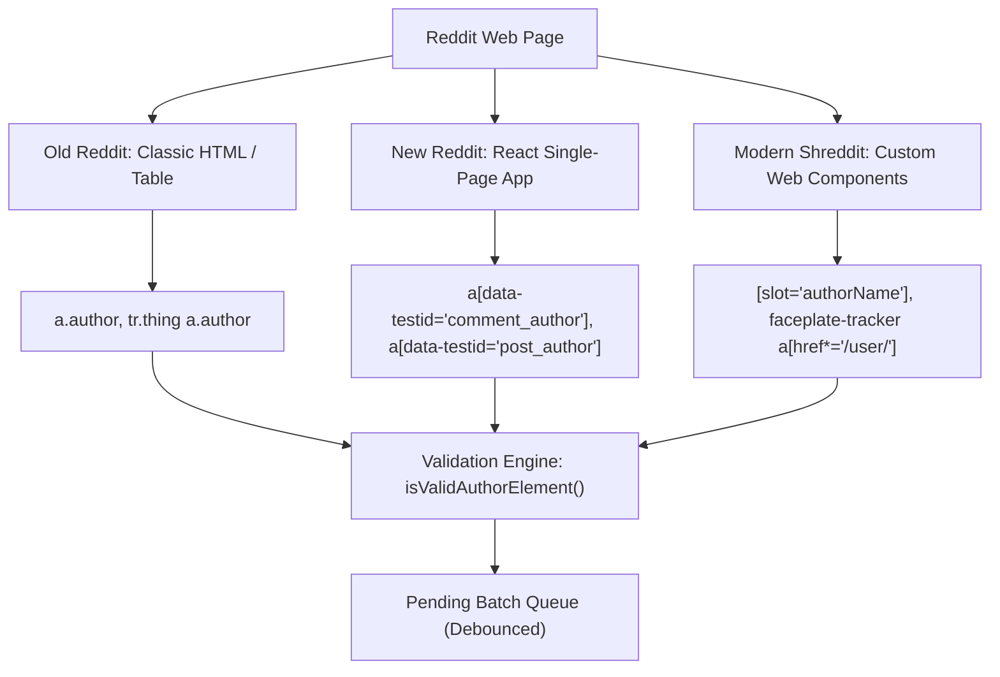

# Browser Extension & DOM Architecture

> **Reddit Bot Identifier — Architectural Documentation Suite**  
> *Module:* 05 | *Status:* Production Ready  
> *Navigation:* [← 04 Evidence Hierarchy](file:///home/lazy_pirate/projects/reddit-bot-identifier/docs/04_Three_Tier_Evidence_Hierarchy_and_Latency.md) | **05 Extension UI** | [06 Benchmark Validation →](file:///home/lazy_pirate/projects/reddit-bot-identifier/docs/06_Benchmark_Methodology_and_Validation.md)

---

## 1. Overview & Extension Principles

The **Reddit Bot Identifier Extension** (`extension/`) is a client-side interface built for Google Chrome, Brave, and Edge using **Manifest V3**. It injects real-time bot probability metrics directly into Reddit discussion threads.

The extension is designed around four strict principles:
1. **Zero DOM Pollution & No Layout Shifts:** Avoid shifting comment layouts or obscuring user flairs, awards, or profile pictures.
2. **Single-Badge Discipline:** Render exactly one badge per comment, positioned consistently to the right of the author handle.
3. **No Overflow Clipping:** Prevent tooltips from being clipped by nested comment containers with `overflow: hidden`.
4. **Multi-Generation DOM Compatibility:** Support Old Reddit, New Reddit, and Modern Reddit (Shreddit Web Components).

---

## 2. Multi-Generation Reddit DOM Parsing

Reddit's frontend exists in three distinct architectures, all of which are actively served depending on user preferences and Reddit's A/B tests:



### Targeted DOM Selectors ([`extension/content.js`](file:///home/lazy_pirate/projects/reddit-bot-identifier/extension/content.js#L274-L290)):
```javascript
const selectors = [
  '[slot="authorName"]:not([data-rbi-checked])',                     // Shreddit comments & posts
  'a[data-testid="comment_author"]:not([data-rbi-checked])',          // New Reddit comments
  'a[data-testid="post_author"]:not([data-rbi-checked])',             // New Reddit posts
  'a[data-testid="author-link"]:not([data-rbi-checked])',             // Web author links
  'a[href*="/user/"]:not([data-rbi-checked])',                        // General author anchors
  'a[href*="/u/"]:not([data-rbi-checked])',                           // Shortform user anchors
  'a.author:not([data-rbi-checked])',                                 // Old Reddit author anchors
  'faceplate-tracker[source="post_author"] a:not([data-rbi-checked])' // Shreddit feed post authors
];
```

---

## 3. Anti-False-Positive DOM Validation Engine

Reddit's DOM contains user links in avatars, badges, comment body mentions (e.g. *"talk to u/someone"*), and navigation menus. Naive DOM scanners produce multiple badges across a single comment or tag user mentions inside quote blocks.

To solve this, every candidate element passes through [`isValidAuthorElement(el, username)`](file:///home/lazy_pirate/projects/reddit-bot-identifier/extension/content.js#L181-L228):

```javascript
function isValidAuthorElement(el, username) {
  // 1. Reject if element is an avatar, icon, or inside an avatar container
  if (el.closest('[slot*="Avatar"], [data-testid*="avatar" i], .avatar') ||
      el.matches('[slot*="Avatar"], [data-testid*="avatar" i]')) {
    return false;
  }

  // 2. Reject if element contains SVG/image with no visible text
  if (el.querySelector('faceplate-img, img, svg') && !el.innerText.trim()) {
    return false;
  }

  // 3. Reject if inside comment markdown body or paragraphs (user mentions)
  if (el.closest('[data-testid="comment-body"], .usertext-body, [slot="comment-body"], .md p, p')) {
    return false;
  }

  // 4. Reject navigation links (settings, messages)
  const href = el.getAttribute("href") || "";
  if (href.includes("/message/") || href.includes("/settings/")) {
    return false;
  }

  // 5. Parent container uniqueness: check if comment container already has a badge
  const parentContainer = el.closest('shreddit-comment, shreddit-post, div.comment, [data-testid="comment"], article');
  if (parentContainer && (parentContainer.dataset.rbiLabeled === "true" || parentContainer.querySelector('.rbi-badge'))) {
    return false;
  }

  return true;
}
```

This ensures that **exactly one badge** is created per comment or post, placed strictly next to the true author name.

---

## 4. The Single-Badge UI Philosophy

In early UI iterations, the extension displayed redundant, bulky indicators:
- A badge over the profile avatar picture (which glitched and overlapped with Reddit's native flairs).
- A second badge displaying words like `[BOT: 98%]` or `[HUMAN: 4%]`, creating visual noise.

### The Modern Unified Badge
The current interface streamlines the display to a **single percentage pill**:

```
[Profile Pic]   u/AutoModerator  [ 98% ]   •  2h ago
```

- Shows **only the percentage** (e.g. `98%`, `4%`), leaving the interface clean and legible.
- Placed directly into the author row via `insertAfter(authorElement, badgeElement)`.
- Accessible via keyboard navigation and screen readers with proper ARIA attributes:
  ```javascript
  badge.setAttribute("role", "status");
  badge.setAttribute("aria-label", `Bot likelihood: ${scorePct}%`);
  ```

---

## 5. Continuous 7-Tier Color Gradient Spectrum

To convey nuanced probability without arbitrary black-and-white binning, scores are mapped to a continuous 7-tier chromatic spectrum ([`extension/styles.css`](file:///home/lazy_pirate/projects/reddit-bot-identifier/extension/styles.css#L31-L86)):

```
  0% ─────────── 30% ─────────── 60% ─────────── 85% ─────────── 100%
  [ Emerald ]   [ Sky Blue ]    [ Orange ]    [ Crimson ]    [ Hot Red ]
  (Pristine)     (Unverified)   (Suspicious)   (Likely Bot)   (Confirmed)
```

| Tier | Score Range | Color Hex | CSS Class | Rationale & Visual Semantics |
|---|---|---|---|---|
| **Tier 1** | $0\% - 14\%$ | `#10b981` | `.rbi-tier-1` | **Pure Emerald Green:** Normal human conversational rhythms. |
| **Tier 2** | $15\% - 29\%$ | `#14b8a6` | `.rbi-tier-2` | **Teal / Cyan-Green:** Organic human with mild automation or flairs. |
| **Tier 3** | $30\% - 44\%$ | `#06b6d4` | `.rbi-tier-3` | **Sky Blue:** Low sample size or unverified casual account. |
| **Tier 4** | $45\% - 59\%$ | `#eab308` | `.rbi-tier-4` | **Warm Amber / Gold:** Moderate irregularity, sleeper account, or brand rep. |
| **Tier 5** | $60\% - 74\%$ | `#f97316` | `.rbi-tier-5` | **Tangerine Orange:** High suspicion, hyper-monomania or rapid switching. |
| **Tier 6** | $75\% - 85\%$ | `#f43f5e` | `.rbi-tier-6` | **Coral Crimson:** Likely automated bot or commercial link farm. |
| **Tier 7** | $86\% - 100\%$ | `#ff1744` | `.rbi-tier-7` | **Neon Hot Red:** Confirmed bot (Tier 1/2 verified or superhuman 24/7). |

---

## 6. High-Performance Global Floating Tooltip

A common issue in modern web extensions is tooltip clipping: when a tooltip is appended inside a deeply nested comment component with `overflow: hidden`, the card gets cut off by the container edge.

### The Singleton Body-Anchored Architecture
The extension utilizes a single persistent tooltip element attached directly to `document.body` ([`extension/content.js`](file:///home/lazy_pirate/projects/reddit-bot-identifier/extension/content.js#L19-L94)):

```javascript
// Singleton attached to document.body
let globalTooltip = document.getElementById("rbi-global-tooltip");
```

```
┌─────────────────────────────────────────────────────────────────┐
│ u/AutoModerator                         98% Bot Likelihood      │
│ [Tier 1: Deterministic]                                         │
├─────────────────────────────────────────────────────────────────┤
│ Meta: 0.25    Temporal: 0.85    Linguistic: 1.00    Network: 0.00│
├─────────────────────────────────────────────────────────────────┤
│ • Tier 1: Definitive automated bot disclaimer in comments       │
│ • Near-uniform 24h activity — no sleep trough detected          │
└─────────────────────────────────────────────────────────────────┘
```

### Viewport Boundary Collision Detection
When a user hovers over a badge, `showTooltip(badgeEl, data)` dynamically calculates viewport coordinates:
1. Centers horizontally over the badge: `rect.left + (rect.width / 2) - (tooltipRect.width / 2)`.
2. Clamps against left and right window borders with a $10\text{px}$ safety margin.
3. Detects top viewport boundary clipping: if `rect.top - tooltipHeight < 0`, the tooltip smoothly flips to render **below** the badge instead of above it.

---

## 7. Real-Time On-Page Comment Extraction

When an account has their Reddit profile history set to private, traditional API lookups fail. However, the comment the user just posted is **plainly visible right on the page**.

The content script extracts this visible text via [`extractCommentBody(element)`](file:///home/lazy_pirate/projects/reddit-bot-identifier/extension/content.js#L109-L132) across:
- Shreddit slots: `[slot="comment"]` and `div[id*="-comment-rtjson-content"]`
- React test IDs: `div[data-testid="comment-body"]`
- Old Reddit markdown: `div.usertext-body, div.md`

This extracted body is packaged into the batch payload and sent to the API server. Even with zero historical comments on file, the backend can immediately run Layer 3 text forensics on the visible comment.

---

> [!TIP]
> **Next Step:** To inspect the real-world validation results, edge-case bot analyses, and quantitative benchmark scores, proceed to **[06 Benchmark Methodology & Real-World Validation](file:///home/lazy_pirate/projects/reddit-bot-identifier/docs/06_Benchmark_Methodology_and_Validation.md)**.
