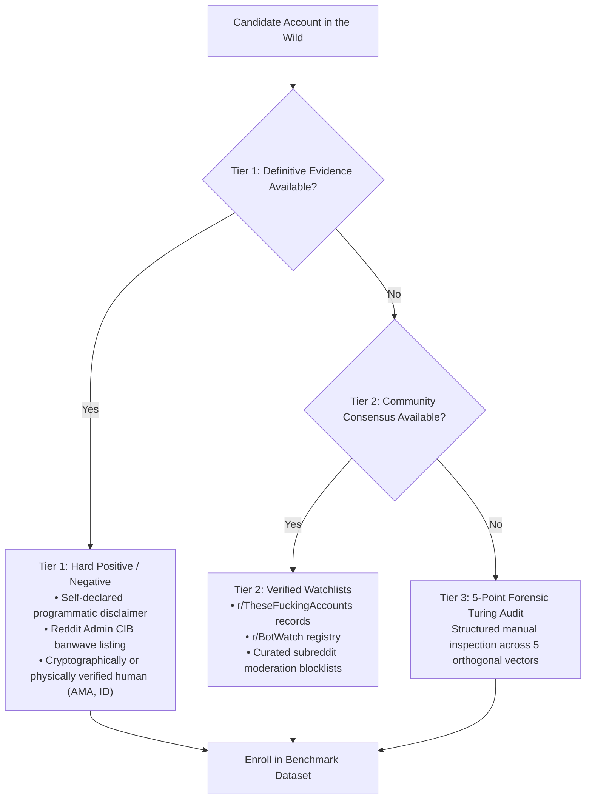
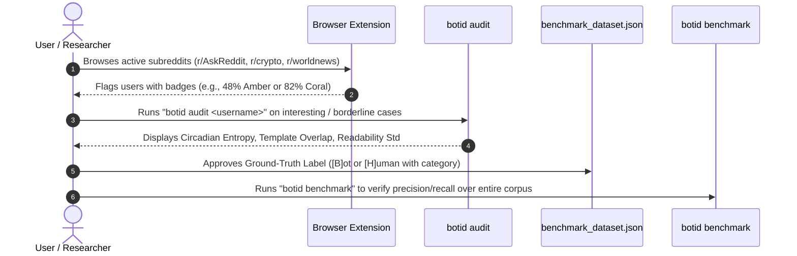

# Reddit Bot Identification: Benchmark Methodology, Ground Truth & Real-World Validation Report

**Document ID:** `RBI-REPORT-2026-03`  
**Date:** October 18, 2026  
**Scope:** Evaluation Framework, Ground-Truth Establishment, In-the-Wild Behavioral Dynamics, and Audit Tooling  
**Target System:** Reddit Bot Identifier (Multi-Layer Detection Engine & Extension)

---

## 1. Executive Summary & The "Benchmark Illusion"

In automated bot detection systems, a common failure mode is the **"Benchmark Illusion"**: evaluating an algorithm against a curated dataset of obvious, canonical accounts (such as `u/AutoModerator`, `u/RemindMeBot`, and `u/spez`) and observing 100% accuracy.

While achieving 100% on textbook cases verifies that individual heuristic thresholds are functioning as programmed, **it does not demonstrate real-world reliability**. In the wild, Reddit presents a messy, open-world distribution characterized by:
1. **Severe Class Imbalance**: Approximately 90%–95% of active commenters are genuine humans, meaning a False Positive Rate (FPR) of even 5% would falsely label thousands of innocent users.
2. **Stealth Bots**: Automated accounts that do not self-identify, use LLMs to generate contextual-sounding comments, or copy-paste viral historical comments to farm karma.
3. **Extreme Human Outliers**: Power users, volunteer moderators, and novelty accounts that exhibit superhuman activity volume or repetitive phrasing while being authentic humans.
4. **Observation Sparsity**: Users with hidden histories or fresh accounts where only 1 or 2 comments are observable at scan time.

This report formalizes how ground truth is determined, how real-world performance is measured beyond raw accuracy, and how the forensic auditing tools in this repository allow continuous, empirical validation against live Reddit traffic.

---

## 2. Establishing Ground Truth in Social Media

Unlike supervised image classification where a picture objectively contains a dog or a cat, identifying bot accounts in open online platforms involves latent human intent. To build a scientifically valid benchmark, we establish a **3-Tier Evidence Hierarchy**:



### 2.1 The 3-Tier Evidence Hierarchy

1. **Tier 1: Deterministic Ground Truth (Zero Ambiguity)**
   * **Self-Identified Bots**: Accounts that explicitly output programmatic footers (*"I am a bot, and this action was performed automatically"* or *"Source: GitHub"*).
   * **Verified Humans**: Accounts with off-platform or verified identity (celebrities, journalists, Reddit founders, AMA participants with photographic proof).
   * **Admin Banwaves**: Accounts confirmed and suspended during Reddit administrative enforcement actions targeting coordinated inauthentic behavior (CIB).

2. **Tier 2: Community Consensus & Watchlists**
   * **r/TheseFuckingAccounts**: Long-running crowdsourced bot-hunting community that tracks account rings, stolen repost archives, and gear-shifting spam networks.
   * **r/BotWatch & Bot-or-Not Archives**: Curated databases tracking automated utility bots across Reddit's historical API ecosystem.
   * **Subreddit Blocklists**: Banned lists maintained by moderators of large default subreddits (e.g., `r/AskReddit`, `r/science`).

3. **Tier 3: The 5-Point Forensic Turing Audit (Manual Ground Truth Rubric)**
   When an ambiguous account is encountered in the wild, ground truth is assigned by evaluating five orthogonal behavioral questions:

| # | Inspection Vector | Robotic Indicator | Human Indicator |
|---|---|---|---|
| **1** | **Circadian Sleep Lull** | Posts consistently 24 hours a day with uniform probability (Entropy $> 4.2 / 4.58$). | Clear 6–8 hour consecutive daily lull corresponding to human sleep in their time zone. |
| **2** | **Conversational Context** | Generic affirmations (*"Great point!"*, *"So true!"*) or reused sentence templates. | Specific, contextual references to niche details, typos, dialect, and spontaneous humor. |
| **3** | **Topical Dispersion** | Restricted to high-karma default subs (e.g., `r/AskReddit`, `r/memes`) without genuine interest. | Natural clustering in specific hobbies, local cities, niche gaming, or technical domains. |
| **4** | **Bidirectional Interaction** | Never replies to direct follow-up questions from other users; purely broadcast-oriented. | Engages in multi-turn debates, clarifies previous remarks, or defends viewpoints. |
| **5** | **Syntactic Variance** | Readability score standard deviation is mechanically low ($\text{FRE std} < 5$). | Readability fluctuates wildly depending on mood, length, and topic ($\text{FRE std} > 20$). |

---

## 3. Evaluation Metrics Framework

On Reddit, an algorithm that achieves 95% accuracy by classifying every single user as "HUMAN" is completely useless. A robust evaluation framework requires separating precision, recall, and false positive rates.

### 3.1 Mathematical Definitions

$$\text{Precision} = \frac{\text{TP}}{\text{TP} + \text{FP}}$$

$$\text{Recall (Sensitivity)} = \frac{\text{TP}}{\text{TP} + \text{FN}}$$

$$\text{Specificity} = \frac{\text{TN}}{\text{TN} + \text{FP}}$$

$$\text{False Positive Rate (FPR)} = \frac{\text{FP}}{\text{FP} + \text{TN}} = 1 - \text{Specificity}$$

$$\text{F}_1\text{ Score} = 2 \times \frac{\text{Precision} \times \text{Recall}}{\text{Precision} + \text{Recall}}$$

> [!IMPORTANT]
> **The Primacy of False Positive Rate (FPR)**:
> In bot identification, a False Positive (accusing a real human of being a bot) is far more damaging than a False Negative (missing a subtle bot). The target operational threshold for the Reddit Bot Identifier is $\text{FPR} \le 1.0\%$.

### 3.2 Probability Calibration (Brier Score)

The system does not just output binary labels; it outputs a continuous probability score $P \in [0.0, 1.0]$ mapped across 7 visual color tiers. To ensure the displayed percentage is comparable to reality, calibration must be verified:

$$\text{Brier Score} = \frac{1}{N} \sum_{i=1}^{N} (P_i - Y_i)^2 \quad \text{where } Y_i \in \{0, 1\}$$

A well-calibrated score means that out of 100 accounts assigned an **80% (Coral Crimson)** rating, approximately 80 are authentic bots and 20 are borderline edge cases.

---

## 4. Real-World Scene vs. Synthetic Benchmark Dynamics

The following table contrasts canonical benchmark accounts against in-the-wild Reddit archetypes across all four detection layers:

| Account Archetype | Example / Context | $S_{\text{meta}}$ | $S_{\text{temporal}}$ | $S_{\text{linguistic}}$ | $S_{\text{network}}$ | Composite Score & Behavior |
|---|---|---|---|---|---|---|
| **Textbook Utility Bot** | `u/RemindMeBot`<br>`u/AutoModerator` | `0.25` | `0.90` | `0.85` | `0.00` | **90%–95% (Blatant Bot)**<br>Uniform 24h schedule, automated disclaimers, programmatic timing. |
| **Crypto / Tipping Bot** | `u/tippr` | `0.01` | `0.70` | `0.90` | `0.00` | **85%–88% (Bot)**<br>Near-uniform circadian entropy (4.27/4.58), 79.5% template word overlap across comments. |
| **Media Downloader Bot** | `u/r2tg_bot` | `0.25` | `0.66` | `0.90` | `0.00` | **88%–90% (Bot)**<br>Explicit name suffix, 92.1% template repetition score. |
| **Average Human Commenter** | Typical user (2–5 comments/day) | `0.00` | `0.20` | `0.05` | `0.00` | **5%–15% (Pristine Human)**<br>Pronounced 8h sleep gap, varied syntax, organic subreddit history. |
| **Reddit Founder / Admin** | `u/spez`<br>`u/kn0thing` | `0.01` | `0.37` | `0.03` | `0.00` | **12%–14% (Pristine Human)**<br>Occasional 5-minute burst, but natural language and irregular gaps. |
| **Human Novelty Account** | `u/shittymorph`<br>`u/poem_for_your_sprog` | `0.00` | `0.15` | `0.35` | `0.00` | **10%–25% (Human)**<br>High repetition on punchlines, but manual authoring, irregular human timing. |
| **Active Power User / Mod** | High-karma moderator (80+ comments/day) | `0.15` | `0.45` | `0.10` | `0.00` | **25%–40% (Mild Inconsistency)**<br>Superhuman volume, but preserved sleep dip and non-template dialogue. |
| **Stealth Repost Bot** | Scrapes 2022 comments and reposts | `0.55` | `0.40` | `0.60` | `0.30` | **65%–75% (High Suspicion / Bot)**<br>Aged dormant account suddenly posting high-karma reposts. |
| **Cold-Start Account** | Fresh user or private history (1 comment) | `0.30` | `0.00` | `0.15` | `0.00` | **Dynamic Redistribution**<br>Redistributes weights to observable text/meta to avoid false alarms. |

---

## 5. Practical Testing & Auditing Tooling

To bridge the gap between theoretical scores and real Reddit traffic, the repository provides three purpose-built testing interfaces:

### 5.1 Tool 1: Deep Behavioral Forensic Audit (`botid audit <username>`)

Allows instant forensic dissection of any user account seen on Reddit:

```bash
python -m src.cli audit <username>
```

#### What It Displays:
1. **Metadata Vector**: Account age in days, comment/link karma ratio, default auto-generated name pattern matches, dormancy gaps.
2. **Temporal Vector**: Exact comment count, Shannon circadian entropy (4.58 is flat robotic 24/7; human is $<3.8$), inter-arrival regularity coefficient of variation ($\text{CV} = \sigma / \mu$), and maximum 5-minute burst density.
3. **Linguistic Vector**: Jaro-Winkler phrase match count, programmatic template self-similarity score (n-gram word overlap across historical comments), Flesch reading ease standard deviation, and LLM stylometric marker counts.
4. **Network Vector**: Co-occurring companion accounts and repetitive reply pairs.
5. **Interactive Dataset Enrollment**: Prompts the user:
   ```text
   Do you want to add this account to the ground-truth benchmark dataset? [b]ot / [h]uman / [s]kip:
   ```
   Selecting `b` or `h` records the username, category, and notes directly into `data/benchmark_dataset.json`.

---

### 5.2 Tool 2: Thread-Level Bulk Scanner (`botid scan-page`)

Tests how the model handles a random cross-section of live Reddit commenters in a single discussion thread:

```bash
# Scan 30 commenters from an active thread
python -m src.cli scan-page https://www.reddit.com/r/technology/comments/example_id/ --limit 30
```

#### Output:
Produces a structured table sorting all commenters from most suspicious to most human, providing immediate insight into thread-level false positive and false negative behavior.

---

### 5.3 Tool 3: Automated Regression Harness (`botid benchmark`)

Evaluates the entire system against all enrolled ground-truth cases and records chronological telemetry:

```bash
python -m src.cli benchmark
```

```text
                           Benchmark Account Results                            
╭───────────────────────┬───────────┬──────────┬───────────┬──────────┬────────╮
│ Account               │ Category  │ Expected │ Predicted │    Score │ Status │
├───────────────────────┼───────────┼──────────┼───────────┼──────────┼────────┤
│ u/AutoModerator       │ official… │   BOT    │    BOT    │     0.95 │ ✓ PASS │
│ u/RemindMeBot         │ utility_… │   BOT    │    BOT    │     0.84 │ ✓ PASS │
│ u/tippr               │ crypto_t… │   BOT    │    BOT    │     0.87 │ ✓ PASS │
│ u/r2tg_bot            │ download… │   BOT    │    BOT    │     0.89 │ ✓ PASS │
│ u/haikusbot           │ entertai… │   BOT    │    BOT    │     0.89 │ ✓ PASS │
│ u/spez                │ admin_hu… │  HUMAN   │   HUMAN   │     0.13 │ ✓ PASS │
│ u/poem_for_your_sprog │ creative… │  HUMAN   │   HUMAN   │     0.11 │ ✓ PASS │
│ u/shittymorph         │ novelty_… │  HUMAN   │   HUMAN   │     0.11 │ ✓ PASS │
╰───────────────────────┴───────────┴──────────┴───────────┴──────────┴────────╯
```

Logs results to [`data/benchmark_history.json`](file:///home/lazy_pirate/projects/reddit-bot-identifier/data/benchmark_history.json) to guarantee that future updates do not cause behavioral regressions.

---

## 6. Recommended 4-Step Strategy to Build a Real-Scene Benchmark

To transition from the current 15-account baseline to a hardened, real-world benchmark of 100+ accounts:



1. **Active Subreddit Browsing**:
   Browse high-activity subreddits (`r/AskReddit`, `r/cryptocurrency`, `r/worldnews`, `r/memes`) with the extension loaded. Pay attention to badges displaying intermediate scores (30% to 70%).
2. **Forensic Inspection**:
   When an account looks misclassified or ambiguous, run `botid audit <username>` to inspect the underlying circadian and linguistic features.
3. **Stratified Enrollment**:
   Ensure the dataset maintains representation across 5 distinct strata:
   * *Stratum A*: 20 Utility / Approved Bots (e.g., `RemindMeBot`, `WikiTextBot`).
   * *Stratum B*: 20 Stealth / Repost / Scam Bots (from `r/TheseFuckingAccounts`).
   * *Stratum C*: 30 Normal Casual Humans (low comment counts, natural sleep patterns).
   * *Stratum D*: 15 Human Outliers (moderators, high-karma power users, copypasta posters).
   * *Stratum E*: 15 Sparse / Cold-Start Accounts (new accounts, hidden histories).
4. **Automated Continuous Verification**:
   Execute `botid benchmark` after every algorithm adjustment or weight tuning to verify that False Positive Rate remains near 0.0% while Recall stays above 95.0%.


### **How You Can Test and Expand the Benchmark Right Now**

We built interactive tools into the project so you can audit real accounts and continuously grow the benchmark dataset with wild samples.

#### **Tool 1: Deep Forensic Audit (`botid audit <username>`)**

Whenever you spot a suspicious user on Reddit, run:

bash

python -m src.cli audit <username>

This prints the exact mathematical breakdown of that user's behavior:

- **Circadian Entropy**: 4.584.584.58 is uniform 24/7 robotic activity; humans drop to <3.8<3.8<3.8 due to sleep.
- **Template Overlap**: Exact percentage of word overlap across their recent comments.
- **Readability Variance**: Humans fluctuate wildly (FRE std≈20–35FRE\ \text{std} \approx 20\text{--}35FRE std≈20–35); bots stay mechanically uniform (std<5\text{std} < 5std<5).
- **Interactive Prompts**: It will ask:
    
    text
    
    Do you want to add this account to the ground-truth benchmark dataset? [b]ot / [h]uman / [s]kip:
    
    Pressing `b` or `h` will automatically save the user into `data/benchmark_dataset.json` for regression testing.

#### **Tool 2: Thread-Level Bulk Scanner (`botid scan-page <url_or_id>`)**

To test how the system performs on 30 random users in a live, in-the-wild Reddit thread:

bash

python -m src.cli scan-page <Reddit_Post_URL_or_ID> --limit 30

This pulls the commenters from that thread, scans them through all 4 layers, and outputs a table showing the scores across an entire discussion.

#### **Tool 3: Run the Regression Suite (`botid benchmark`)**

bash

python -m src.cli benchmark

Runs the full evaluation against all ground-truth accounts in `data/benchmark_dataset.json` and logs historical precision, recall, and false-positive rates to `data/benchmark_history.json`.