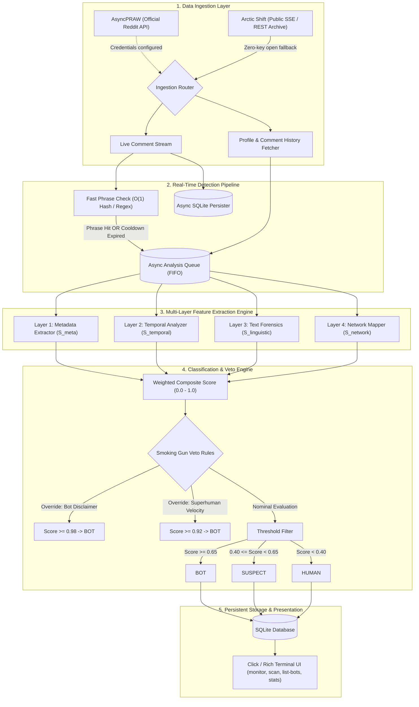
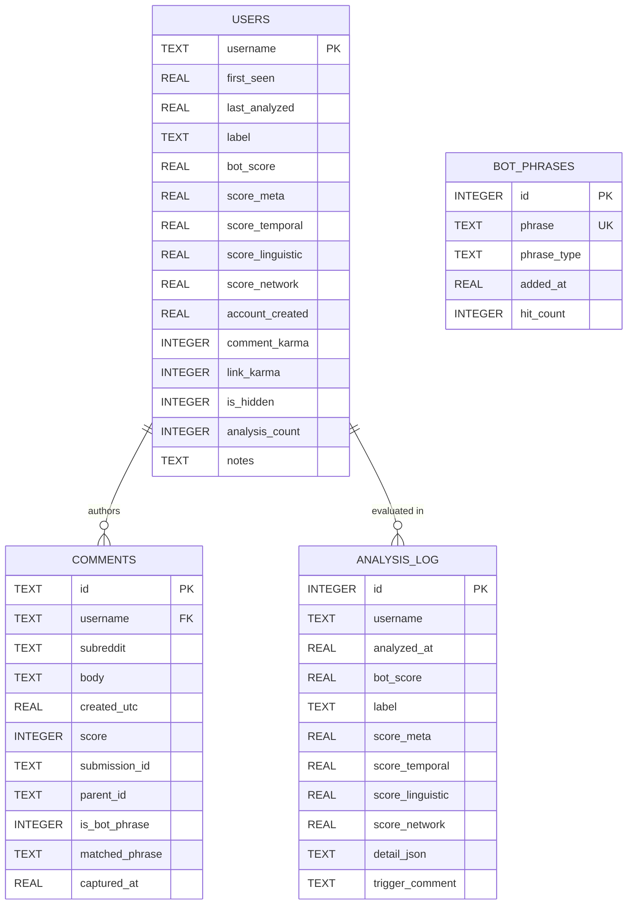

# Reddit Bot Identifier: System Architecture & Technical Implementation Report

## 1. Executive Architecture Overview

The **Reddit Bot Identifier** is an asynchronous, multi-tiered detection engine engineered to monitor, analyze, and classify Reddit accounts in real-time. It operates on a **defense-in-depth scoring model** that combines account metadata heuristics, temporal and activity velocity forensics, natural language processing (NLP) stylometry, and graph co-occurrence analysis.



---

## 2. File Organization & Module Responsibilities

| Path | Purpose & Responsibilities |
| :--- | :--- |
| [`config/settings.py`](file:///home/lazy_pirate/projects/reddit-bot-identifier/config/settings.py) | Centralized, typed configuration loader. Reads environment variables from `.env` with fallbacks for weights, API thresholds, and DB paths. |
| [`data/bot_phrases.py`](file:///home/lazy_pirate/projects/reddit-bot-identifier/data/bot_phrases.py) | Static knowledge base of known bot patterns: 56 exact phrases, 15 fuzzy patterns, and 20 compiled regular expressions for LLM tone and scam vectors. |
| [`src/collectors/reddit_collector.py`](file:///home/lazy_pirate/projects/reddit-bot-identifier/src/collectors/reddit_collector.py) | **Dual-engine data ingestor**. Primary: AsyncPRAW (OAuth); Fallback: Arctic Shift REST API. Supplies `fetch_redditor_profile()` and `stream_subreddit_comments()`. |
| [`src/features/metadata_extractor.py`](file:///home/lazy_pirate/projects/reddit-bot-identifier/src/features/metadata_extractor.py) | **Layer 1: $S_{\text{meta}}$**. Evaluates username regexes (default auto-names, bot handles), dormancy gaps (sleeper accounts), karma asymmetry, and suspension flags. |
| [`src/features/temporal_analyzer.py`](file:///home/lazy_pirate/projects/reddit-bot-identifier/src/features/temporal_analyzer.py) | **Layer 2: $S_{\text{temporal}}$**. Computes Shannon entropy of circadian 24h activity, inter-arrival time (IAT) variance, sliding-window burst posting, and cross-subreddit dispersion velocity. |
| [`src/features/text_forensics.py`](file:///home/lazy_pirate/projects/reddit-bot-identifier/src/features/text_forensics.py) | **Layer 3: $S_{\text{linguistic}}$**. Executes substring phrase matching, windowed fuzzy matching (Jaro-Winkler), RLHF/LLM tone marker frequency, Flesch reading ease standard deviation, and generic karma-bait heuristics. |
| [`src/features/network_mapper.py`](file:///home/lazy_pirate/projects/reddit-bot-identifier/src/features/network_mapper.py) | **Layer 4: $S_{\text{network}}$**. Queries historical SQLite records for co-occurrence rings (users active in the same threads within seconds), recurring reply pairs, and associations with previously confirmed bots. |
| [`src/models/bot_classifier.py`](file:///home/lazy_pirate/projects/reddit-bot-identifier/src/models/bot_classifier.py) | **The Decision Core**. Fuses the 4 layers, dynamically shifts weights when comment histories are hidden, evaluates non-linear "smoking gun" veto overrides, and persists logs. |
| [`src/db/database.py`](file:///home/lazy_pirate/projects/reddit-bot-identifier/src/db/database.py) | Async SQLite storage layer with WAL mode. Manages `users`, `comments`, `analysis_log`, and dynamic `bot_phrases` tables with full indexing. |
| [`src/monitor.py`](file:///home/lazy_pirate/projects/reddit-bot-identifier/src/monitor.py) | Real-time monitoring loop. Processes live comments, triggers fast-path checks, manages asynchronous worker queues, enforces per-user cooldowns, and renders Rich terminal cards. |
| [`src/cli.py`](file:///home/lazy_pirate/projects/reddit-bot-identifier/src/cli.py) | User CLI built with Click and Rich. Provides `scan`, `monitor`, `list-bots`, `stats`, `add-phrase`, and `setup` commands. |
| [`tests/test_features.py`](file:///home/lazy_pirate/projects/reddit-bot-identifier/tests/test_features.py) | Comprehensive unit test suite (16 tests) validating metadata scoring, temporal distribution math, and linguistic forensics. |

---

## 3. Detailed Logic & Check Criteria by Module

### 3.1 Data Ingestion (`reddit_collector.py`)
To prevent the application from failing when Reddit credentials are unavailable or blocked by Reddit's "Responsible Builder Policy", the collector employs an **automatic dual-engine strategy**:

```
Has Valid Credentials?
 ├── YES ──> AsyncPRAW (OAuth2) ──> Reddit Official API
 └── NO  ──> Arctic Shift REST API ──> Public Open Stream / Archive (Zero Keys Required)
```

1. **Profile Recovery**:
   * Extracts `created_utc`, `comment_karma`, `link_karma`, `is_suspended`, `has_verified_email`.
   * When history is hidden by privacy settings or API blocks, sets `profile.history_hidden = True` to notify downstream scoring modules.
2. **Comment Streaming**:
   * Yields a normalized `LiveComment` dataclass containing `id`, `username`, `subreddit`, `body`, `created_utc`, `score`, `submission_id`, and `parent_id`.

---

### 3.2 Layer 1: Account Metadata ($S_{\text{meta}}$)
Implemented in [`metadata_extractor.py`](file:///home/lazy_pirate/projects/reddit-bot-identifier/src/features/metadata_extractor.py).

$$S_{\text{meta}} = 0.25 U + 0.25 D + 0.20 K + 0.15 A + 0.15 F$$

* **Username Pattern ($U$)**:
  * **Explicit Bot Handles** (`_BOT_NAME_RE`): Matches `(?i)(^bot|bot$|[-_]bot|\bbot\b|automod)`. Score = **0.95**.
  * **Default Reddit Auto-Names** (`_DEFAULT_NAME_RE`): Matches `^[A-Za-z]+[_-][A-Za-z]+[_-]?\d{3,5}$` (e.g., `Cautious_Ad_8492`, `Flat-Mirror-9566`). Score = **0.85**.
  * **Throwaways** (`_THROWAWAY_RE`): Matches `throwaway\d*`, `burner_99`. Score = **0.50**.
* **Dormancy Gap ($D$)**:
  * Calculates: $\Delta_{\text{dormant}} = t_{\text{first\_comment}} - t_{\text{account\_created}}$.
  * If $\text{Age} > 90\text{ days}$ and $\Delta_{\text{dormant}} > 60\text{ days}$, flags as an incubated "sleeper" account:
    $$D = \min\left(\frac{\Delta_{\text{dormant}}}{365}, 1.0\right) \times 0.9$$
* **Karma Asymmetry ($K$)**:
  * Pure link reposters: Link karma $> 95\%$ of total and link karma $> 5000 \implies K = 0.80$.
  * Superhuman comment farming: Karma per day $> 200 \implies K = 0.75$.
* **Account Age ($A$)**:
  * Account $< 3\text{ days old} \implies A = 0.70$.
  * Account $< 14\text{ days old} \implies A = 0.40$.
* **Account Flags ($F$)**:
  * Account suspended $\implies F = 1.0$.
  * History hidden $\implies F = 0.30$.
  * Unverified email $\implies F = \min(F + 0.10, 1.0)$.

---

### 3.3 Layer 2: Temporal & Activity Dynamics ($S_{\text{temporal}}$)
Implemented in [`temporal_analyzer.py`](file:///home/lazy_pirate/projects/reddit-bot-identifier/src/features/temporal_analyzer.py).

#### Baseline Score:
$$S_{\text{base}} = 0.35 C + 0.30 I + 0.20 B + 0.15 D_{\text{sub}}$$

* **Circadian Entropy ($C$)**:
  * Comments are bucketed into 24 one-hour UTC bins: $\{n_0, n_1, \dots, n_{23}\}$.
  * Computes Shannon Entropy:
    $$H = -\sum_{i=0}^{23} p_i \log_2(p_i), \quad p_i = \frac{n_i}{N}$$
  * Normalized against maximum theoretical entropy $H_{\max} = \log_2(24) \approx 4.585$:
    $$C = \frac{H}{H_{\max}}$$
  * Biological humans exhibit a sleep trough ($C < 0.75$). Bots operating around the clock exhibit uniform distributions ($C > 0.90$).
* **Inter-Arrival Time (IAT) Regularity ($I$)**:
  * Measures $\Delta t_i = t_i - t_{i-1}$ for active gaps ($< 6\text{ hours}$).
  * Computes coefficient of variation:
    $$CV = \frac{\sigma_{\Delta t}}{\mu_{\Delta t}}$$
  * If $CV < 0.15$ (rigid timer loop), $I = 0.95$. If $CV < 0.30$, $I = 0.65$.
* **Sliding-Window Burst Posting ($B$)**:
  * Slides a 300-second window across timestamps.
  * $\ge 15\text{ comments in 5 min} \implies B = 1.00$.
  * $\ge 8\text{ comments in 5 min} \implies B = 0.60$.
* **Subreddit Dispersion Velocity ($D_{\text{sub}}$)**:
  * Measures rapid topic switching: proportion of consecutive comment pairs where $\text{subreddit}_{i} \neq \text{subreddit}_{i-1}$ and $\Delta t < 120\text{ seconds}$.
  * Switch rate $> 50\% \implies D_{\text{sub}} = 0.85$.

#### Superhuman Velocity Dominance:
To ensure high burst rates are not diluted by compressed samples where circadian entropy cannot be measured (e.g. 100 comments occurring in a 5-minute slice):
$$S_{\text{temporal}} = \max\Big(S_{\text{base}},\, B \times 0.90,\, D_{\text{sub}} \times 0.85\Big)$$

---

### 3.4 Layer 3: Linguistic & Text Forensics ($S_{\text{linguistic}}$)
Implemented in [`text_forensics.py`](file:///home/lazy_pirate/projects/reddit-bot-identifier/src/features/text_forensics.py).

$$S_{\text{linguistic}} = 0.40 P + 0.25 L + 0.20 R + 0.15 G$$

* **Phrase Database Matching ($P$)**:
  * **Exact Substring Matching**: Verifies whether normalized phrase strings exist inside normalized comment bodies. Avoids string-length penalty pitfalls.
  * **Windowed Fuzzy Matching**: For phrases without exact substring matches, slides an $N$-word window matching the phrase length and calculates Jaro-Winkler similarity:
    $$\text{sim}_{\text{JW}} \ge 0.88 \implies \text{Match flagged}$$
  * **Decay Aggregation**: Comments are weighted using an exponential recency decay $w_i = e^{-0.10 \cdot i}$.
* **LLM / RLHF Stylometric Markers ($L$)**:
  * Pre-compiled patterns scanning for diplomatic hedging (*"while both sides have valid points"*, *"it's important to remember that"*), excessive formal greetings (*"That's a fantastic observation!"*), and service closers (*"Hope this clears things up! Feel free to ask..."*).
  * Measures the proportion of comments containing $\ge 2$ distinct markers.
* **Readability Uniformity ($R$)**:
  * Calculates Flesch Reading Ease across the user's comment sample.
  * Measures $\sigma_{\text{FRE}}$. Human writing varies across moods and subreddits ($\sigma > 20$). LLMs produce uniform readability bands ($\sigma_{\text{FRE}} < 5 \implies R = 0.90$).
* **Generic Platitude Heuristic ($G$)**:
  * Identifies short comments ($< 80$ characters) stripped of personal pronouns (`I`, `we`, `my`) and logical conjunctions (`because`, `however`). High ratio indicates universal karma baiting.

---

### 3.5 Layer 4: Network & Graph Coordination ($S_{\text{network}}$)
Implemented in [`network_mapper.py`](file:///home/lazy_pirate/projects/reddit-bot-identifier/src/features/network_mapper.py).

$$S_{\text{network}} = 0.45 \text{CoOccur} + 0.30 \text{ReplyPairs} + 0.25 \text{KnownBotAssoc}$$

* **Co-Occurrence Analysis**: Queries SQLite for other accounts appearing in the same thread IDs within 90 seconds. Flags users who co-occur in $>30\%$ of observed threads.
* **Reply-Pair Tracking**: Detects synthetic conversation loops where Bot B repeatedly replies to Bot A to create artificial debate or post phishing links.
* **Known Bot Association**: Checks what fraction of co-occurring accounts are already labeled `BOT` or `SUSPECT` in the local database.

---

## 4. Scoring Ensemble & Non-Linear Veto Logic

Implemented in [`bot_classifier.py`](file:///home/lazy_pirate/projects/reddit-bot-identifier/src/models/bot_classifier.py).

### 4.1 Nominal Weighted Average
$$\text{RawScore} = w_1 S_{\text{meta}} + w_2 S_{\text{temporal}} + w_3 S_{\text{linguistic}} + w_4 S_{\text{network}}$$

| Weight Configuration | $w_1$ (Meta) | $w_2$ (Temporal) | $w_3$ (Linguistic) | $w_4$ (Network) |
| :--- | :---: | :---: | :---: | :---: |
| **Standard Profile** | `0.25` | `0.25` | `0.30` | `0.20` |
| **Hidden History Fallback** ($<5$ comments) | `0.40` | `0.05` | `0.45` | `0.10` |

### 4.2 Non-Linear "Smoking Gun" Veto Rules
Real-world bot detection cannot rely purely on linear weighted averages, as high account age or karma can mask blatant automation. The classifier evaluates three definitive overrides:

1. **Self-Identified Bot Disclaimer**:
   * If any comment contains an automated disclaimer (`"I am a bot, and this action was performed automatically"`):
   $$\text{FinalScore} = \max(\text{RawScore}, 0.98) \implies \mathbf{BOT}$$
2. **Superhuman Velocity Override**:
   * If $B \ge 1.0$ ($>15$ comments in 5 min) and $D_{\text{sub}} \ge 0.80$ ($>50\%$ multi-sub rapid hopping):
   $$\text{FinalScore} = \max(\text{RawScore}, 0.92) \implies \mathbf{BOT}$$
3. **Explicit Bot Naming Override**:
   * If the handle contains an explicit bot name and exhibits elevated temporal or linguistic signals:
   $$\text{FinalScore} = \max(\text{RawScore}, 0.85) \implies \mathbf{BOT}$$

### 4.3 Classification Thresholds
* $\text{Score} \ge 0.65 \implies$ **`BOT`**
* $0.40 \le \text{Score} < 0.65 \implies$ **`SUSPECT`**
* $\text{Score} < 0.40 \implies$ **`HUMAN`**

---

## 5. Storage Architecture & Real-Time Monitor

### 5.1 SQLite Schema & Optimization (`database.py`)
The system uses an asynchronous SQLite database (`aiosqlite`) stored at `./data/botdb.sqlite` configured with indexing for sub-millisecond lookups:



### 5.2 Stream Monitor Engine (`monitor.py`)
The streaming pipeline uses an asynchronous producer-consumer architecture:

1. **Producer (`stream_subreddit_comments`)**:
   * Ingests real-time comments.
   * Runs an immediate, non-blocking $O(1)$ substring/regex check against `data/bot_phrases.py`.
   * Stores the comment in `comments` table.
2. **Consumer (`_analysis_worker`)**:
   * Pulls from an in-memory `asyncio.Queue(maxsize=500)`.
   * Enforces a 60-second per-user cooldown and a 6-hour re-analysis cycle to avoid redundant processing.
   * Renders colorized classification cards to the terminal in real-time.

---

## 6. Verification & Test Coverage

The engine is covered by an automated test suite ([`tests/test_features.py`](file:///home/lazy_pirate/projects/reddit-bot-identifier/tests/test_features.py)):

* **`TestMetadataExtractor` (6 tests)**:
  * Default username pattern recognition (`Adjective_Noun_1234`).
  * Normal username low scoring.
  * Suspended account handling.
  * Account age risk gradient.
  * Karma asymmetry evaluation.
  * Clean profile human baseline.
* **`TestTemporalAnalyzer` (4 tests)**:
  * 24h uniform posting circadian entropy ($H / H_{\max} > 0.80$).
  * Synthetic timer IAT regularity detection ($CV < 0.15$).
  * Minimum comment sample boundary handling ($< 3$ comments).
  * Sliding-window burst detection ($>15$ comments in 5 min).
* **`TestTextForensics` (6 tests)**:
  * Substring exact phrase matching in long bodies.
  * Multiple LLM tone marker detection.
  * Human colloquial text baseline.
  * Scam vector pattern recognition.
  * Multi-comment recency decay scoring.
  * Empty comment boundary handling.
